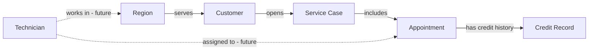

# Contoso service operations: Fabric ontology guide

**Status:** proposed design for discussion; no Fabric ontology, Fabric data bindings or new SQL tables have been created by this guide. Examples use synthetic demo data. Fabric ontology and the Fabric Ontology knowledge source are preview features; check the current documentation and tenant configuration before implementation.

## Objective

Model how Contoso customers, cases and appointments relate, then add regions and technicians as the demo grows. The goal is to ask business questions across cases, such as “Which pending cases involve more than one missed appointment?” and “Which technician was assigned to each visit?”

The existing demo already uses Azure SQL for current case details and a Foundry Prompt Agent with a SharePoint-backed policy knowledge base. The ontology would provide an additional business view over operational data available in Fabric; SharePoint remains the authority for approved policy wording, and SQL remains the operational source for case status and updates.

Solid relationships can be derived from the existing SQL schema, although Region needs a derived entity table. Dashed relationships require new data. “Incident” is currently represented through an appointment's outcome and related case; there is no separate Incident table.

## Existing and proposed entity types

The SQL source is `ContosoServiceDemo`. The table names and fields below refer to the current seed script, `sql/01_create_and_seed.sql`. Names of Fabric tables are proposed; verify actual table names when bringing the data into OneLake.

| Entity type | Business definition | Entity key | Useful properties | Data readiness |
| --- | --- | --- | --- | --- |
| **Customer** | A customer receiving Contoso services. | `CustomerId` | `DisplayName`, `Region`, `ServiceTier`, `AccountStatus` | Existing SQL table `dbo.Customers`. |
| **Service Case** | A customer request or complaint being managed by Customer Operations. | `CaseId` | `CustomerId`, `Category`, `Summary`, `RequestedCreditEur`, `CaseStatus`, `OpenedAtUtc`, `UpdatedAtUtc` | Existing SQL table `dbo.Cases`. |
| **Appointment** | A scheduled service visit associated with a case. | `AppointmentId` | `CaseId`, `ScheduledDate`, `IsConfirmed`, `CustomerAvailable`, `Outcome`, `ProviderCaused` | Existing SQL table `dbo.Appointments`. Nullable fields are unknown when null. |
| **Credit Record** | A historical credit entry for an appointment; not the same as a proposed request or a confirmed external billing transaction. | `CreditId` | `AppointmentId`, `AmountEur`, `CreditStatus`, `RecordedAtUtc` | Existing SQL table `dbo.CreditHistory`; seeded records are synthetic. |
| **Region** | A named area used to group customers for the demo. | `RegionName` | `RegionName` | No Region table exists. Create a distinct, normalized Region dataset from `Customers.Region` in Fabric for the prototype, then bind it. |
| **Technician** | A technician or service partner carrying out a visit. | `TechnicianId` | Name, trade, employment or partner type, status | **Future:** no Technician table or assignments exist in the current SQL schema. |
| **Service Incident** | A distinct service event or problem associated with an appointment. | `IncidentId` | Type, reported time, description, disposition | **Optional future:** use only if an incident needs its own history or multiple incidents per appointment. Appointment outcome covers the current demo. |

The existing examples use customer `C-1042` and case `CASE-1042`; they are separate keys. That case links to appointments `A-7781` and `A-7829`. There are no seeded technician assignments for those visits, so do not invent them as existing facts.

## Relationship types and binding hints

Create unique relationship names. The cardinality column expresses the intended business relationship, not a claim that Fabric automatically enforces those constraints. Bind the relationship to the appropriate OneLake data or mapping table and validate actual instances.

| Origin | Relationship | Target | Intended cardinality | Proposed source keys / binding |
| --- | --- | --- | --- | --- |
| Customer | `customerHasCase` | Service Case | One customer → many cases; each existing case → one customer | `Customers.CustomerId` ↔ `Cases.CustomerId`. |
| Service Case | `caseHasAppointment` | Appointment | One case → many appointments; each existing appointment → one case | `Cases.CaseId` ↔ `Appointments.CaseId`. |
| Appointment | `appointmentHasCreditRecord` | Credit Record | One appointment → zero or more credit records; each credit record → one appointment | `Appointments.AppointmentId` ↔ `CreditHistory.AppointmentId`. |
| Region | `regionServesCustomer` | Customer | One region → many customers; each current customer row has one region value | Derived `Region.RegionName` ↔ `Customers.Region`. This describes the region recorded on the customer; it does not prove where a specific visit occurred. |
| Technician | `technicianAssignedToAppointment` | Appointment | A technician may serve many appointments; an appointment may have multiple or changing assignments | **Future:** add an assignment dataset with `TechnicianId`, `AppointmentId`, role and assignment times; bind it as a mapping table. |
| Technician | `technicianWorksInRegion` | Region | Many technicians ↔ many regions if the business permits it | **Future:** add a technician-region mapping dataset; do not assume a customer's region is the technician's assignment. |
| Appointment | `appointmentHasIncident` | Service Incident | One appointment → zero or more incidents | **Future:** `Appointments.AppointmentId` ↔ `Incidents.AppointmentId`, if a separate incident dataset is introduced. |

Fabric's relationship configuration uses an origin and target entity and can use a mapping table where needed. See [Create relationship types](https://learn.microsoft.com/en-us/fabric/iq/ontology/how-to-create-relationship-types).

## Data binding and freshness

The ontology is a semantic model, not a replacement for the case database. The current SQL database is **not yet bound to Fabric**. To populate entity and relationship instances:

1. Choose and configure an appropriate supported path to make the SQL demo tables available as Fabric/OneLake data, such as a suitable mirroring or ingestion approach. Verify actual support, permissions and costs for the chosen SQL configuration before selecting it.
2. Make the required tables or suitable derived datasets available in the workspace. Create the distinct Region dataset if Region is modeled as an entity.
3. Bind each entity type to its dataset, map the key and properties, then bind the relationships using the source keys above.
4. Check entity and relationship instances, row counts, null values and case `CASE-1042` against the source database.
5. Measure how long a SQL status change takes to appear in the Fabric data **and** ontology graph. The Fabric ontology source is queried at request time, but that does not make upstream SQL replication or graph refresh instantaneous. Microsoft notes that upstream changes can require a manual ontology refresh; verify the behavior of the selected setup. [Bind data](https://learn.microsoft.com/en-us/fabric/iq/ontology/how-to-bind-data) · [Relationship refresh note](https://learn.microsoft.com/en-us/fabric/iq/ontology/how-to-create-relationship-types)

Keep the existing direct SQL lookup and case-status controls for the initial prototype. Use them to compare current operational data against ontology results. Do not use potentially stale Fabric data as the sole basis for an irreversible action.

## Suggested validation questions

| Question | Expected result or check | Data required |
| --- | --- | --- |
| Which customer opened `CASE-1042`? | `C-1042`, Alex Morgan in the original synthetic seed. | Customer + Service Case. |
| Which appointments belong to `CASE-1042`? | `A-7781` and `A-7829`, both provider no-shows in the original seed. | Service Case + Appointment. |
| Which pending cases have more than one provider no-show? | Compare against SQL; seeded `CASE-1042` qualifies while its status is Pending. | Case + Appointment, with current status. |
| Which cases have already issued credits? | In the original seed, `CASE-1044` and `CASE-1046` have issued credit records; verify current data and state before demonstrating. | Case + Appointment + Credit Record. |
| Which technicians were assigned to `CASE-1042`? | **Not answerable yet:** technician assignments are not in the existing SQL data. | Future Technician + assignment dataset. |
| What does the service-credit policy allow for `CASE-1042`? | Combine operational evidence with a cited SharePoint policy; keep the outcome subject to operator approval. | Ontology or SQL plus the separate SharePoint knowledge source. |

## Fabric configuration checklist

1. Confirm an appropriately licensed Fabric workspace/capacity, tenant settings for ontology, and access to the data and workspace. Ontology availability and supported bindings are preview-dependent.
2. Create a new ontology item, for example **Contoso Service Operations**.
3. Add the first entity types and keys from the table above. Give each a clear business description and synonyms such as “service visit” for Appointment and “support case” for Service Case.
4. Bind the entities and relationships to the prepared Fabric data. Start with Customer, Service Case, Appointment and Credit Record; add Region after its dataset exists. Add Technician only after assignment data exists.
5. Validate instances, relationship directions and the questions above in Fabric. Record the data-refresh lag and any mismatches.
6. Create a **Fabric Ontology knowledge source** in Azure AI Search/Foundry IQ, referencing the Fabric workspace and ontology. Start in a separate test knowledge base and preserve the existing SharePoint-backed agent until the new path is verified.
7. Test retrieval and source attribution, then decide whether to use one combined knowledge base or separate tools for ontology and SharePoint. Keep policy and operational facts distinguishable in the answer.

Fabric Ontology knowledge sources require a Fabric workspace and ontology item, the same Entra tenant as the Search service, and **low or medium** retrieval reasoning effort. Queries require end-user identity passed separately for an on-behalf-of flow; the demo's existing Search/project managed-identity connection alone does not establish that flow. Validate the actual user-token path and permissions before claiming per-user access or connecting the web app. [Fabric Ontology knowledge source](https://learn.microsoft.com/en-us/azure/search/agentic-knowledge-source-how-to-fabric-ontology)

## Optional OWL / Turtle import

Microsoft documents preview import of `.ttl`, `.rdf` and `.owl` files into a **new, empty** Fabric ontology item. A model generator can express classes, datatype properties and object properties, but Fabric supports a subset of OWL/RDF semantics and can adjust or skip constructs. Review and download the import summary, then verify the resulting model. An ontology definition does not by itself populate the live case data: configure and verify data bindings and keys separately. [Import and export ontologies](https://learn.microsoft.com/en-us/fabric/iq/ontology/how-to-import-export)

For this first version, the tables above are the recommended configuration reference. A small OWL/Turtle file can be generated later once the entity names and relationships are agreed; it should be validated against the current Fabric import behavior rather than treated as a guaranteed deployable artifact.
