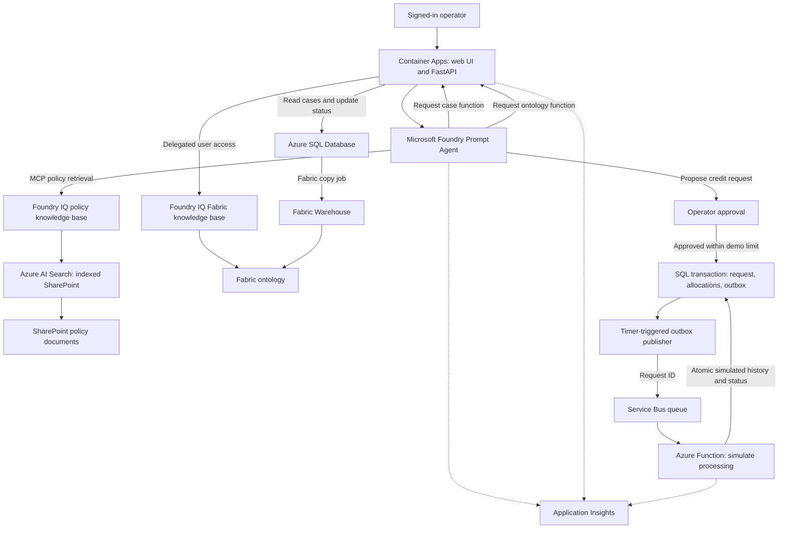

<p align="center">
  <a href="#tech-stack">
    
  </a>
</p>

<h1 align="center">Contoso Service Intelligence</h1>

**A service agent that brings case data, business policies, and an enterprise ontology together—with a person in control of the action.**

[Try the demo](#try-the-demo) · [Scenario](#the-contoso-scenario) · [Tech stack](#tech-stack) · [Architecture](#architecture) · [Documentation](#documentation)

## Introduction

Contoso Service Intelligence is an agentic customer-service solution that connects business reasoning to a governed, event-driven workflow. A **Microsoft Foundry Prompt Agent** brings together current case data from **Azure SQL**, policies from **SharePoint**, and business relationships from a **Microsoft Fabric ontology**, using separate **Foundry IQ** knowledge bases for the two knowledge sources. After an operator reviews a proposed action, **Azure Service Bus** and **Azure Functions** handle the approved request asynchronously, with telemetry in **Application Insights**.

Contoso Home Services is a fictional global field-service company offering electrical, plumbing, heating and cooling, appliance installation, and handyman services. Its service team handles appointments, customer cases, and requests for service credits. The company and its demo customer data are synthetic.

The deployed demo uses real Azure and Microsoft 365 services. Credit requests are **simulated**: approving one records a request in SQL for asynchronous processing; it does not issue a refund, send an email, or connect to a billing system.

## Features

- Browse customer cases, select one, and update its status to **Pending** or **Resolved** in Azure SQL.
- Ask a Foundry Prompt Agent to combine current case and appointment details with approved policy information.
- Retrieve indexed SharePoint policy documents through a Foundry IQ knowledge base and display source attribution.
- Ask about customers, regions, and operational relationships using a Fabric ontology exposed through a separate Foundry IQ knowledge base.
- Review and approve or decline a proposed service-credit request; the application enforces the demo's €150 frontline submission limit.
- Persist approved requests, appointment allocations, and an outbox event together in Azure SQL. An Azure Function publishes the event to Service Bus; another records simulated credit history. The web app displays request status.
- Inspect Foundry agent traces, application telemetry, and Function logs in Application Insights.
- Use Microsoft Entra sign-in and a delegated user token for Fabric ontology access. The application executes the agent's SQL and Fabric function calls.

The agent is a **Foundry Prompt Agent**, not an application built with Microsoft Agent Framework. Foundry IQ retrieves SharePoint policy through MCP; the Fabric ontology is queried by a separate, client-executed function. Fabric reflects a warehouse snapshot, so it can lag behind Azure SQL.

## The Contoso scenario

Customer **C-1042**, Alex Morgan, has case **CASE-1042** concerning two missed appointments. The operator can examine the case, ask what evidence and policy rules apply, and review a proposed credit request. The demo distinguishes a policy limit from an approval: the agent can propose an action, but the operator must approve it.

The example case and policy values are fictional. `C-1042` is a customer ID; `CASE-1042` is a case ID. The SharePoint documents determine the policy evidence available in the deployed demo. If a document or fact is missing, the agent should say so.

See [the company overview](data/contoso-company-overview.md) for the broader business context and [demo-prompts.txt](demo-prompts.txt) for example questions.

## From question to action

1. **Understand the case.** An operator selects a case in the Container Apps web application. The agent can request the current customer, appointment and credit-history facts from Azure SQL.
2. **Ground the reasoning.** For policy questions, the agent retrieves the approved SharePoint documents through Foundry IQ and MCP. For questions about customers, regions and relationships, it can use a separate Foundry IQ knowledge base backed by the Fabric ontology. SQL remains the authority for current case facts; Fabric is a warehouse snapshot.
3. **Keep a person in control.** The agent can propose a simulated credit with an allocation for each eligible appointment. The application validates the evidence and limits, and an operator must approve before the request is saved.
4. **Process the approved request reliably.** The app commits the request, allocations and a transactional outbox event to SQL. A timer-triggered Function publishes the request ID to Service Bus, and a queue-triggered Function records simulated appointment credits and updates the status. Retries and duplicate deliveries are part of the design; no real refund is issued.
5. **Inspect the result.** The operator can ask about the updated credit history. Application Insights brings Foundry traces, web telemetry and Function logs together, with the request ID available for cross-component investigation.

The agent chooses tools based on the question and its instructions; routing and answers can vary and should be evaluated. The SharePoint policy tool and Fabric ontology tool use different connection and identity paths, as described below.

## Try the demo

After deploying and configuring the solution in your own environment, open the web application's Container App in the Azure portal and select its application URL. Sign in with an account authorized for your deployment; Fabric questions also require access to Azure AI Search and the Fabric workspace. A user may be prompted to consent to delegated access. Browser verification of the Fabric sign-in flow is still pending.

The demo is not permanently hosted. The repository's infrastructure scripts cover the original setup, not the complete integration described here; review [setup and local verification](#setup-and-local-verification) and the component guides before deploying.

1. Select **CASE-1042** in the case list and review its current status.
2. Ask: “What happened with this case, and what service-credit rules apply?” Inspect the case facts and policy attribution.
3. Ask the agent to prepare an eligible service-credit request. Review the case ID, appointment allocations and total, then choose **Approve** or **Decline**. The resulting request is a simulation.
4. Ask: “Which customers are in EU South?” The agent can use the Fabric ontology to answer.
5. Change a case status and, when needed, use the [reset script](sql/02_reset_demo_statuses.sql) to restore the five seeded case statuses.

Model output can vary. A case-status update is independent of a credit request. Fabric data changes appear only after the copy job and any required ontology refresh have completed.

After approving a request, allow up to a minute for the scheduled publisher, refresh **Credit requests**, and look for `Processed`. Ask about the case's credit history again: the newly recorded entries should say `Simulated`. The application prevents a second simulated credit for an appointment that already has an issued or simulated entry. Resetting case statuses does not clear credit history.

`CASE-1045` is a missing-evidence example: customer availability for appointment `A-7832` is unknown. The demo's action validation requires recorded positive confirmation, customer availability and provider responsibility before accepting an allocation. Missing data is not evidence that the customer was unavailable; an operator should verify and record the fact first. This is the demo's conservative validation rule; review the policy wording and business rules when adapting it.

## Tech stack

| Layer | Technologies and responsibilities |
|---|---|
| User interface | HTML, CSS, and JavaScript for case selection, chat, status changes, and approval. |
| Application | Python, FastAPI, and Uvicorn for agent calls, SQL and Fabric tool execution, and the simulated action. |
| Agent | Microsoft Foundry Prompt Agent with policy retrieval and client-executed function tools. |
| Policy knowledge | Foundry IQ and Azure AI Search with an indexed SharePoint knowledge source. |
| Operational data | Azure SQL Database stores customers, cases, appointments, and credit history. |
| Business context | A Fabric Warehouse and ontology, exposed through a Fabric Ontology knowledge source in Foundry IQ. |
| Identity and hosting | Microsoft Entra sign-in, managed identity, and Azure Container Apps. |
| Asynchronous processing | Azure Service Bus queue and a Python Azure Function process approved simulated requests. |
| Observability | Azure Monitor Application Insights receives Foundry server-side traces, web telemetry, and Function logs. |
| Infrastructure and operations | Bicep, PowerShell, Azure CLI, and SQL scripts. |

## Architecture

The web app hosts the user interface and executes the SQL and Fabric functions requested by the Foundry agent. SharePoint supplies policy documents; Azure SQL supplies current case facts; Fabric supplies an additional view of business entities and relationships.



The active policy path uses SharePoint. An earlier Blob-backed knowledge base remains available as a fallback in the demonstrated environment. It is not the active policy source. The Fabric copy job replaced the earlier mirroring approach.

### Why use a queue?

An operator-approved request needs a durable record and can take time to process. Previously, the demo wrote a JSONL file inside the web container; that file could disappear on restart. A SQL request record and Service Bus queue separate the approval experience from a small Function that simulates downstream processing. Service Bus can retry a failed delivery and move repeatedly failing messages to its dead-letter queue. The Function uses the request ID to make repeated processing of an already completed request safe.

The application commits the request, each appointment allocation, and an outbox record **in one SQL transaction**. A timer-triggered Function leases pending outbox records and sends each request ID to Service Bus. If a publisher crashes or cannot confirm a send, the lease expires or the event is retried. Delivery is at least once, so the consumer locks the request, rechecks the appointments and existing history, and writes all simulated entries and the `Processed` status in one transaction. Duplicate deliveries of an already processed request have no additional effect. A permanent processing error can still dead-letter a message and requires an operator to investigate.

`PendingDispatch` means the request and outbox event are saved, `Queued` means publication was recorded, and `Processed` means the Function completed the **simulation**. A fast consumer can move directly from `PendingDispatch` to `Processed`. None of these states means money was issued. `CreditHistory` uses `Simulated` for these new entries; the original `Issued` records are preserved.

### Observability

The Foundry project has an Application Insights connection for server-side agent traces. The web app exports request, dependency, and selected tool/action telemetry, while the Function emits its execution logs to the same resource. Use the request ID to correlate a simulated credit request with Function logs; full distributed trace continuity across the queue has not been verified. Foundry traces can contain prompts or retrieved content, so apply appropriate access and retention controls.

## Documentation

| Guide | Purpose |
|---|---|
| [Project log and backlog](PROJECT-LOG.md) | Current deployment, decisions, completed work, verification, and follow-up items. |
| [Demo prompts](demo-prompts.txt) | Example policy, action, ontology, and combined-source questions. |
| [Web app guide](webapp/README.md) | Application endpoints, settings, local rehearsal, and hosting notes. |
| [SQL guide](sql/README.md) | Database setup, synthetic seed data, managed-identity permissions, and status reset. |
| [Credit processor](credit-processor/) | Azure Function source for the approved-request queue. |
| [Fabric ontology guide](CONTOSO-ONTOLOGY-GUIDE.md) | Entity and relationship design, source mapping, and validation ideas. Some sections describe the original proposal; consult the project log for the current implementation. |
| [Infrastructure guide](infra/README.md) | Original Bicep deployment and Blob-based setup. |

## Setup and local verification

The repository contains scripts for the original standalone Foundry, Search, and Blob-based demo. **They do not provision the complete deployed SharePoint, SQL, Fabric, Entra sign-in, and Container Apps integration.** Use the project log and component guides to understand the additional configuration before adapting the sample to another environment.

For the original infrastructure path, see [infra/README.md](infra/README.md). The SQL scripts require a dedicated database and appropriate permissions; see [sql/README.md](sql/README.md). The Fabric tool also needs a configured ontology knowledge base and a delegated Search token for each signed-in user. A Foundry playground alone does not execute the client-side SQL or Fabric functions.

To run the offline, deterministic rehearsal from this directory:

```powershell
python -m venv .venv
.\.venv\Scripts\Activate.ps1
pip install -r requirements.txt
python scripts/rehearsal_mode.py
```

Rehearsal uses the original bundled Markdown fixtures and scripted answers; it does not query the deployed SharePoint, SQL, or Fabric sources.

To run the web application's local tests after installing its dependencies:

```powershell
pip install -r webapp/requirements.txt httpx
python -m unittest webapp.test_cases
```

The local tests use mocks and do not establish that Azure access, user consent, SharePoint indexing, or Fabric token delegation works in a particular tenant. See [webapp/README.md](webapp/README.md) for the web application and rehearsal options.

## Boundaries and follow-up

- The credit action is simulated. Request status is stored in SQL; no real payment or refund is made. The offline rehearsal continues to use a local JSONL file.
- Outbox retries and idempotent consumption reduce the SQL-to-queue failure gap, but don't make external systems transactional. Investigate persistent pending requests and dead-lettered messages; alerts and operational replay are not yet automated.
- The app is designed as a single-presenter demo. Its in-process conversation and approval state are not a scalable multi-user session store.
- The indexed SharePoint path has not been verified for per-user document-level permission trimming. Fabric access uses a separate delegated user-token flow and requires a signed-in browser test.
- SharePoint indexed knowledge sources and Fabric ontology integration use preview features. Check availability, permissions, behavior, and costs in your environment.
- A production solution would need durable audit storage, stronger session isolation, monitoring, evaluation, and integration with an authorized business action service.

## References

- [Foundry IQ overview](https://learn.microsoft.com/en-us/azure/foundry/agents/concepts/what-is-foundry-iq)
- [Agentic retrieval in Azure AI Search](https://learn.microsoft.com/en-us/azure/search/agentic-retrieval-concept)
- [Fabric Ontology knowledge source](https://learn.microsoft.com/en-us/azure/search/agentic-knowledge-source-how-to-fabric-ontology)
- [Microsoft Fabric ontology](https://learn.microsoft.com/en-us/fabric/iq/ontology/overview)
- [Function calling in Microsoft Foundry](https://learn.microsoft.com/en-us/azure/foundry/agents/how-to/tools/function-calling)
