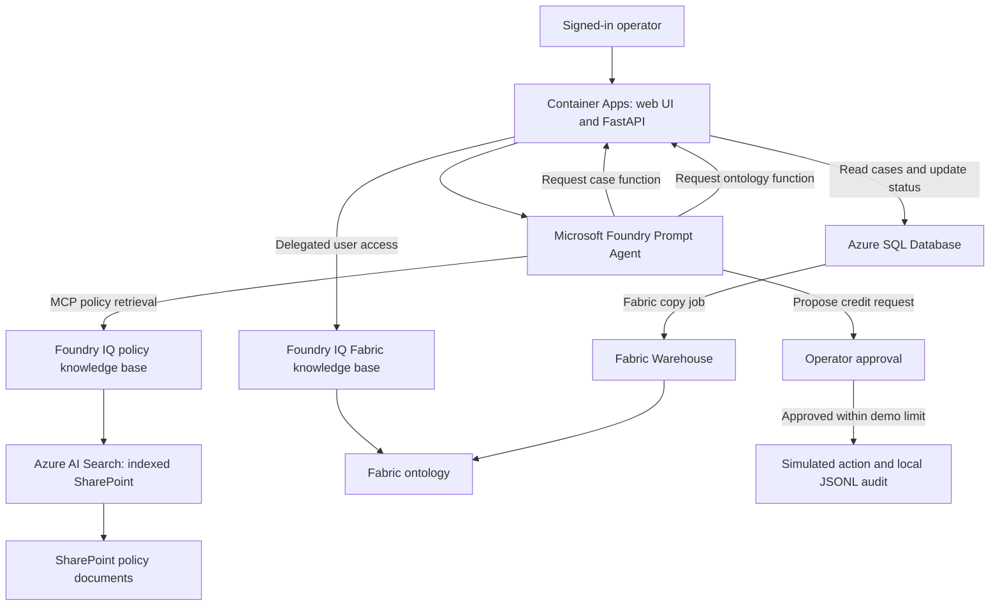

<p align="center">
  <a href="#tech-stack">
    
  </a>
</p>

<h1 align="center">Contoso Service Intelligence</h1>

**A service agent that brings case data, business policies, and an enterprise ontology together—with a person in control of the action.**

[Try the demo](#try-the-demo) · [Scenario](#the-contoso-scenario) · [Tech stack](#tech-stack) · [Architecture](#architecture) · [Documentation](#documentation)

## Introduction

Contoso Service Intelligence is a sample application for exploring how an AI agent can answer customer-service questions using enterprise data and approved policies. It combines a **Microsoft Foundry Prompt Agent**, **Foundry IQ**, **Azure SQL**, **SharePoint**, and a **Microsoft Fabric ontology** in a browser-based experience.

Contoso Home Services is a fictional global field-service company offering electrical, plumbing, heating and cooling, appliance installation, and handyman services. Its service team handles appointments, customer cases, and requests for service credits. The company and its demo customer data are synthetic.

The deployed demo uses real Azure and Microsoft 365 services. Credit requests are **simulated**: approving one writes a local demo audit record; it does not issue a refund, send an email, or connect to a billing system.

## Features

- Browse customer cases, select one, and update its status to **Pending** or **Resolved** in Azure SQL.
- Ask a Foundry Prompt Agent to combine current case and appointment details with approved policy information.
- Retrieve indexed SharePoint policy documents through a Foundry IQ knowledge base and display source attribution.
- Ask about customers, regions, and operational relationships using a Fabric ontology exposed through a separate Foundry IQ knowledge base.
- Review and approve or decline a proposed service-credit request; the application enforces the demo's €150 frontline submission limit.
- Use Microsoft Entra sign-in and a delegated user token for Fabric ontology access. The application executes the agent's SQL and Fabric function calls.

The agent is a **Foundry Prompt Agent**, not an application built with Microsoft Agent Framework. Foundry IQ retrieves SharePoint policy through MCP; the Fabric ontology is queried by a separate, client-executed function. Fabric reflects a warehouse snapshot, so it can lag behind Azure SQL.

## The Contoso scenario

Customer **C-1042**, Alex Morgan, has case **CASE-1042** concerning two missed appointments. The operator can examine the case, ask what evidence and policy rules apply, and review a proposed credit request. The demo distinguishes a policy limit from an approval: the agent can propose an action, but the operator must approve it.

The example case and policy values are fictional. `C-1042` is a customer ID; `CASE-1042` is a case ID. The SharePoint documents determine the policy evidence available in the deployed demo. If a document or fact is missing, the agent should say so.

See [the company overview](data/contoso-company-overview.md) for the broader business context and [demo-prompts.txt](demo-prompts.txt) for example questions.

## Try the demo

The deployed application is [Contoso Service Intelligence](https://iq-demo-web.ambitiousisland-c6c4e95e.swedencentral.azurecontainerapps.io/). Sign in with an account authorized for this deployment; Fabric questions also require access to Azure AI Search and the Fabric workspace. A user may be prompted to consent to delegated access. Browser verification of the Fabric sign-in flow is still pending.

1. Select **CASE-1042** in the case list and review its current status.
2. Ask: “What happened with this case, and what service-credit rules apply?” Inspect the case facts and policy attribution.
3. Ask the agent to prepare an eligible service-credit request. Review its arguments and choose **Approve** or **Decline**. The resulting request is a simulation.
4. Ask: “Which customers are in EU South?” The agent can use the Fabric ontology to answer.
5. Change a case status and, when needed, use the [reset script](sql/02_reset_demo_statuses.sql) to restore the five seeded case statuses.

Model output can vary. A case-status update is independent of a credit request. Fabric data changes appear only after the copy job and any required ontology refresh have completed.

## Tech stack

| Layer | Technologies and responsibilities |
|---|---|
| User interface | HTML, CSS, and JavaScript for case selection, chat, status changes, and approval. |
| Application | Python, FastAPI, and Uvicorn for agent calls, SQL and Fabric tool execution, and the simulated action. |
| Agent | Microsoft Foundry Prompt Agent with policy retrieval and client-executed function tools. |
| Policy knowledge | Foundry IQ and Azure AI Search with an indexed SharePoint knowledge source. |
| Operational data | Azure SQL Database stores customers, cases, appointments, and credit history. |
| Business context | A Fabric Warehouse and ontology, exposed through a Fabric Ontology knowledge source in Foundry IQ. |
| Identity and hosting | Microsoft Entra sign-in, managed identity, and Azure Container Apps. |
| Infrastructure and operations | Bicep, PowerShell, Azure CLI, and SQL scripts. |

## Architecture

The web app hosts the user interface and executes the SQL and Fabric functions requested by the Foundry agent. SharePoint supplies policy documents; Azure SQL supplies current case facts; Fabric supplies an additional view of business entities and relationships.



The active policy path uses SharePoint. An earlier Blob-backed knowledge base remains available as a fallback in the demonstrated environment. It is not the active policy source. The Fabric copy job replaced the earlier mirroring approach.

## Documentation

| Guide | Purpose |
|---|---|
| [Project log and backlog](PROJECT-LOG.md) | Current deployment, decisions, completed work, verification, and follow-up items. |
| [Demo prompts](demo-prompts.txt) | Example policy, action, ontology, and combined-source questions. |
| [Web app guide](webapp/README.md) | Application endpoints, settings, local rehearsal, and hosting notes. |
| [SQL guide](sql/README.md) | Database setup, synthetic seed data, managed-identity permissions, and status reset. |
| [Fabric ontology guide](CONTOSO-ONTOLOGY-GUIDE.md) | Entity and relationship design, source mapping, and validation ideas. Some sections describe the original proposal; consult the project log for the current implementation. |
| [Infrastructure guide](infra/README.md) | Original Bicep deployment and Blob-based setup. |

## Setup and local verification

The repository contains scripts for the original standalone Foundry, Search, and Blob-based demo. **They do not provision the complete deployed SharePoint, SQL, Fabric, Entra sign-in, and Container Apps integration.** Use the project log and component guides to understand the additional configuration before adapting the sample to another environment.

For the original infrastructure path, see [infra/README.md](infra/README.md). The SQL scripts require a dedicated database and appropriate permissions; see [sql/README.md](sql/README.md). The Fabric tool also needs a configured ontology knowledge base and a delegated Search token for each signed-in user. A Foundry playground alone does not execute the client-side SQL or Fabric functions.

To run the offline, deterministic rehearsal from this directory:

```powershell
python -m venv .venv
.\.venv\Scripts\Activate.ps1
pip install -r requirements.txt
python scripts/rehearsal_mode.py
```

Rehearsal uses the original bundled Markdown fixtures and scripted answers; it does not query the deployed SharePoint, SQL, or Fabric sources.

To run the web application's local tests after installing its dependencies:

```powershell
pip install -r webapp/requirements.txt httpx
python -m unittest webapp.test_cases
```

The local tests use mocks and do not establish that Azure access, user consent, SharePoint indexing, or Fabric token delegation works in a particular tenant. See [webapp/README.md](webapp/README.md) for the web application and rehearsal options.

## Boundaries and follow-up

- The credit action is simulated; its JSONL audit record is stored inside the container and is not durable across restarts.
- The app is designed as a single-presenter demo. Its in-process conversation and approval state are not a scalable multi-user session store.
- The indexed SharePoint path has not been verified for per-user document-level permission trimming. Fabric access uses a separate delegated user-token flow and requires a signed-in browser test.
- SharePoint indexed knowledge sources and Fabric ontology integration use preview features. Check availability, permissions, behavior, and costs in your environment.
- A production solution would need durable audit storage, stronger session isolation, monitoring, evaluation, and integration with an authorized business action service.

## References

- [Foundry IQ overview](https://learn.microsoft.com/en-us/azure/foundry/agents/concepts/what-is-foundry-iq)
- [Agentic retrieval in Azure AI Search](https://learn.microsoft.com/en-us/azure/search/agentic-retrieval-concept)
- [Fabric Ontology knowledge source](https://learn.microsoft.com/en-us/azure/search/agentic-knowledge-source-how-to-fabric-ontology)
- [Microsoft Fabric ontology](https://learn.microsoft.com/en-us/fabric/iq/ontology/overview)
- [Function calling in Microsoft Foundry](https://learn.microsoft.com/en-us/azure/foundry/agents/how-to/tools/function-calling)
